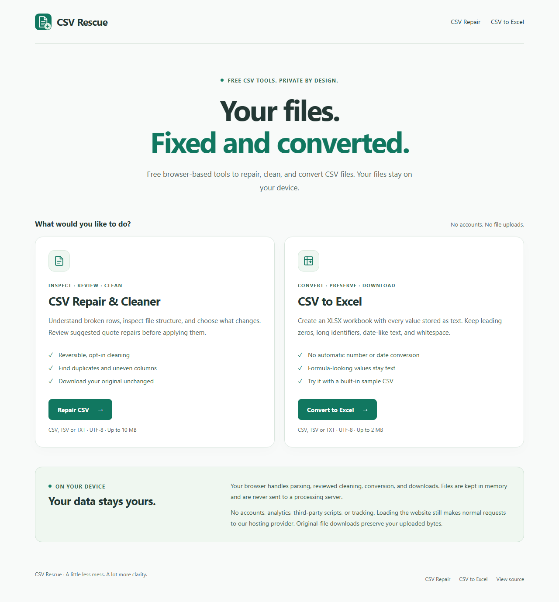
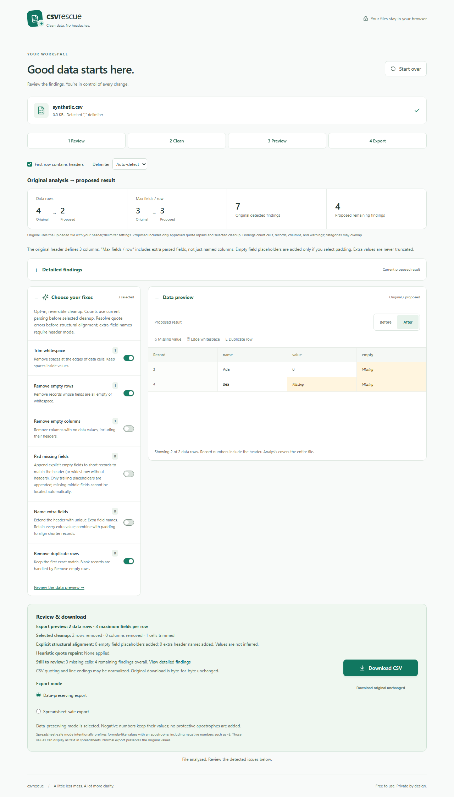

# CSV Rescue

**Your files. Fixed and converted.**

A lightweight collection of CSV tools that runs entirely in your browser. Repair and clean CSV files with reviewed changes, or convert CSV to Excel while preserving text. Free to use, with no accounts, backend, or tracking.

Website: [csv-rescue-app.pages.dev](https://csv-rescue-app.pages.dev/). Version 1.2.0 introduces the tool directory at `/`, [CSV repair at `/csv-repair/`](https://csv-rescue-app.pages.dev/csv-repair/), and [CSV to Excel at `/csv-to-xlsx/`](https://csv-rescue-app.pages.dev/csv-to-xlsx/). See [homepage and SEO release report](docs/SEO_HOMEPAGE_RELEASE.md) and [conversion evaluation](docs/CSV_TO_XLSX_RELEASE.md).



Version **1.2.0** · [Homepage/SEO release report](docs/SEO_HOMEPAGE_RELEASE.md) · [Release history](CHANGELOG.md)

Built as a portfolio product in AI-assisted product development: deterministic local processing, explicit human review for ambiguous repairs, and tested data-preservation boundaries. No AI model or paid API runs in the application.

## Features

- Detect duplicate records, edge whitespace, missing values, empty rows/columns, uneven field counts, and duplicate headers.
- Choose every transformation. All options start off, and disabling them restores their effects from the original dataset.
- Compare Before and After. Analyze the whole supported file while previewing its first 100 data records.
- Review optional malformed-quote repair proposals before applying them; every changed line needs explicit review.
- Keep the mobile workspace compact with collapsible panels and direct Review / Clean / Preview / Export navigation.
- Export locally, optionally neutralize spreadsheet formulas, or download the exact original bytes.
- Use drag/drop or the keyboard-accessible picker on desktop and mobile.

## Quick start

Install Node.js **22.12+** and npm; **24.19.0** is the tested version. From the project directory:

```sh
npm ci
npm run dev
```

Open the local URL printed by Vite. Stop the server with Ctrl+C.

Choose **Repair CSV** from the homepage or navigate directly to `/csv-repair/`. Production builds prerender both tool interfaces; development mounts them normally. For the production routing and no-JavaScript checks, run `npm run build` followed by `npm run preview`, then open `http://127.0.0.1:4173/`. The preview server models Cloudflare's static routing, redirects and 404 responses and binds only to localhost.

On Windows, reopen PowerShell after installing Node if `node` is not recognized. This checkout also provides a launcher that finds Node on PATH or an existing bundled Codex runtime:

```powershell
powershell -ExecutionPolicy Bypass -File .\scripts\start-local.ps1
```

The launcher uses already installed dependencies. It does not download or install Node. A fresh clone requires `npm ci` first.

No environment file is required. To display a repository link, copy `.env.example` to `.env` and set `VITE_GITHUB_URL` to your actual HTTPS GitHub repository. The link is hidden otherwise. No deployment or repository URL is invented.

## Try it

Upload `examples/messy-contacts.csv`, enable a fix, switch to After, then disable the fix to see it reverse. Download the cleaned file or its unchanged original. Additional synthetic fixtures demonstrate semicolon quoting, no-header tab-separated data, and structural warnings.



[Compact mobile workspace](docs/screenshots/compact-mobile.png) · [Expanded mobile preview](docs/screenshots/review-mobile.png) · [Quote-repair review](docs/screenshots/quote-repair.png)

Screenshots contain only intentionally synthetic data. Refresh them after a successful E2E run by copying the selected `test-results/*-upload.png`, `*-review.png`, and `*-quote-repair.png` files to `docs/screenshots/`. Other generated artifacts are ignored.

## Supported CSV formats

UTF-8 and UTF-8 BOM; comma, semicolon, tab, and pipe separators; LF and CRLF line endings; quoted delimiters, escaped quotes, multiline quoted values, empty cells, and files with or without headers. Files must be CSV, TSV, or plain text, up to **10 MB**.

Header mode initially assumes a header. Verify it and the detected delimiter before cleaning. UTF-8 replacement characters or NUL bytes produce an encoding warning; the app does not claim encoding repair.

## What changes, and what stays under your control

Every result is recalculated from the immutable parsed source in this order:

1. Trim data-cell edges; retain internal whitespace and header labels.
2. Remove completely empty data rows.
3. Remove columns empty across the remaining data, including their headers.
4. If selected, extend the header with unique `Extra field N` names, preserving extra values.
5. If selected, append empty trailing fields to match the current header (or widest data row without headers).
6. Remove exact duplicate nonempty rows, retaining the first in original order.

Blank records are handled only by the empty-row option. Empty-column removal stays off by default and retains header-only schema if no data remains. Missing values are reported, never invented. Zero is a value, not a missing cell. Uneven rows are padded only with the explicit **Pad missing fields** option; extra fields are never truncated. **Name extra fields** extends the header, preserving original names and avoiding name collisions. Enable both to align ragged records while preserving all values. Empty placeholders do not reconstruct missing information or locate missing middle fields. Structural options wait for quote errors to be resolved, and reset when parsing settings or quote approval change. Padding that would expand the data beyond 2 million fields is skipped with an explicit warning.

Findings combine records, cells, columns, and parsing warnings; categories may overlap. Empty rows are counted separately from missing cells and duplicates. The selected fixes can create new duplicates, so After is analyzed independently. Trim counts include processed cells in rows subsequently removed. Original statistics remain fixed to uploaded parsing; proposed statistics include approved repairs and selected fixes. “Max fields / row” includes extra fields and differs from the named header width. Quote repairs may change parsing dimensions without deleting columns. Export displays its resulting row/field counts and the counts of removed rows/columns and trimmed cells.

CSV serialization can normalize quoting and line endings. Empty fields are quoted to preserve trailing blank records. Only **Download original unchanged** guarantees the exact original bytes.

## Malformed quotes

A quoted value needs both opening and closing quotes. A quote inside it must be doubled: `"He said ""hello"""`. Broken quoting can swallow following records into a single cell.

When parsing reports quote errors, the app offers suggested edits with original/suggested text for each changed physical line. Open the repair details, inspect the highlighted original/proposed physical lines, and mark every line reviewed. Approval stays disabled while the details are closed or any line is unreviewed. Then explicitly select **Apply suggested quote repairs**. Uncheck it to restore the original parsing. Before always shows original parsing; After includes approved repairs plus selected cleanup. Delimiter changes reset quote approval.

The heuristic can escape inner quotes, close a final unterminated value, or close a value before a likely new record. Boundary guesses require matching field counts; numeric first fields require a numeric next first field too. Syntactically valid quoted fields are protected from the boundary-splitting heuristic, including multiline notes with row-like content. Malformed quoting can still be ambiguous, so suggestions cannot guarantee intended boundaries. Other structural problems stay flagged. Original bytes remain available throughout.

## Privacy and security

**Your files stay in your browser.** Parsing, analysis, quote proposals, cleanup, preview, and export run on your device. Uploaded values are rendered as escaped React text. There are no processing requests, analytics, CDN scripts, remote fonts, accounts, or external APIs.

File contents remain in memory only. The app does not write them to localStorage, sessionStorage, IndexedDB, cookies, or logs. Start over removes application references; memory reclamation timing is browser-controlled, not secure erasure. Downloads are deliberately saved by your browser.

Normal requests to load the static site still reach the hosting provider. Host logs, browser extensions, and device security are outside this guarantee. Cloudflare Pages receives security headers from `public/_headers`, including `connect-src 'none'` to block runtime network connections. Local development uses Vite's development connection; production tests use the built static application with the declared headers.

**Data-preserving export is selected by default** and preserves formula-like values, negative numbers, and the current working field values. The export panel provides explicit radio choices for this mode and spreadsheet-safe mode. Export settings never change uploaded bytes or the working dataset. **Spreadsheet-safe export** intentionally prefixes potentially dangerous formula values with an apostrophe. It covers initial `=`, `+`, `-`, `@`, tab, CR, LF, and whitespace-prefixed formula markers. The export summary counts affected values, including headers and negative numbers: `-5` becomes `'-5`, which may display as text or show its apostrophe in a spreadsheet. Spreadsheet behavior varies; this is not a guarantee of universal spreadsheet safety.

## Architecture

### Static website and routes

| Route | Purpose |
| --- | --- |
| `/` | Static landing page and directory of the two implemented tools; no JavaScript |
| `/csv-repair/` | Existing repair/cleaning application, migrated from `/` |
| `/csv-to-xlsx/` | Existing CSV-to-XLSX converter |

Vite emits three physical HTML pages. `scripts/prerender-pages.mjs` uses existing Vite/React server-rendering capabilities **at build time only** to render the initial empty repair and converter views. Browser hydration attaches their existing event handlers and local state. No server/backend is deployed, and uploaded files are never involved in prerendering. A server-only `window` guard keeps the initial repair render safe; browser panel behavior remains the same.

The homepage has native tool links and an independent, small stylesheet. Tool HTML contains visible initial content, navigation, distinct metadata and canonical URLs. Open Graph/social cards use a local PNG. `public/404.html` disables Cloudflare's default SPA fallback; unknown pages and missing assets must return actual 404 statuses. The sitemap lists exactly these three canonical URLs. XLSX/XLS import routes are not published.

**Migration:** `/` stays valid as the new directory and cannot be redirected to repair. Links in this README and tool navigation identify `/csv-repair/` as the repair destination after release. Update portfolio links that specifically promise repair, bookmarks under your control and other editable external references then. Generic product links should continue targeting `/`. No duplicate repair page or cross-canonical workaround is created. The owner approved this migration release; verify live deployment before announcing it.

[Mobile directory preview](docs/screenshots/homepage-mobile.png). Existing repair screenshots below document the workflow; current landing metadata and navigation differ from older screenshots.

### CSV to XLSX

The standalone `/csv-to-xlsx/` page provides file selection, drag/drop and a synthetic sample. Conversion is separate from repair: no trimming, deduplication, type inference or heuristic quote edits. Malformed quoting blocks conversion and links to the existing repair tool.

Every field becomes text in one `CSV data` worksheet, including headers, leading zeros, long IDs, date-like strings, negative values and formula-like content. Excel calculations require explicitly converting text cells afterward. Empty fields and extra fields are retained; absent worksheet cells stay blank. CSV syntax/line endings and absent-versus-empty distinctions are not losslessly represented by a workbook.

UTF-8 only; **2 MB input, 100,000 rows, 256 columns, 200,000 fields, 32,767 UTF-16 code units per cell**, with additional checks after OOXML escape encoding. Unsupported control characters are rejected, never removed. A 30-second timeout and cancellation terminate the conversion worker; output is capped at 20 MB. Limits reduce risk but do not guarantee memory availability on every device.

`src/conversion/csv.ts` validates/parses text independently of cleaning; `workbook.ts` writes explicit string cells and protects literal OOXML escape sequences; `worker.ts` owns decoding/parsing/writing; `Converter.tsx` owns temporary UI state. SheetJS CE 0.20.3 is pinned to its official package URL with lockfile integrity. It has no runtime package dependencies. The library is bundled inside a same-origin worker loaded **only when conversion starts**, never by CSV repair. No runtime CDN or CSP relaxation is used.

The landing page is static Vite HTML with unique metadata/canonical URL, useful crawlable instructions, FAQs and internal links. `public/sitemap.xml` and `robots.txt` include only implemented routes. No XLSX/XLS import, worksheet selection, formula calculation, styling editor or numeric/date inference is implemented.

### CSV repair

React, strict TypeScript, Vite, Tailwind CSS, Papa Parse, and Lucide. No server application or database.

```text
File bytes (memory only)
  → UTF-8 decode and Papa Parse
  → optional, explicitly approved quote-repair proposal
  → immutable parsed records
  → full-file analysis
  → deterministic selected transformations
  → Before / After preview
  → Papa Parse serialization → local Blob download
```

| Module | Responsibility |
| --- | --- |
| `src/csv/parse.ts` | File validation, delimiter detection, immutable parsing, warnings |
| `src/csv/analyze.ts` | Full-file quality diagnostics |
| `src/csv/repair.ts` | Reversible raw-text quote proposals |
| `src/csv/clean.ts` | Pure transformations and change counts |
| `src/csv/export.ts` | CSV serialization, safe export, local download |
| `src/components/Preview.tsx` | Semantic, horizontally scrollable data preview |
| `src/App.tsx` | Ephemeral UI state and workflow |
| `tests/` | Unit, component, and production browser tests |

## Verification

```sh
npm test
npm run typecheck
npx playwright install chromium
npm run test:e2e
npm run build
npm audit
npm audit --omit=dev
npm run preview
```

E2E tests build production assets and run them through a local-only QA static server with the declared Pages headers. They cover desktop/mobile workflows, quote approvals, download bytes, blank/uneven/wide files, HTML-like cells, no runtime processing requests, empty browser storage, keyboard entry, selected text contrast, and layouts at 320/768/1440 pixels. Playwright normally installs browsers in a user cache; set `PLAYWRIGHT_BROWSERS_PATH` first if you need a different location.

Conversion tests additionally inspect generated ZIP/XML independently of SheetJS, verify actual browser downloads, text-only cells, literal OOXML escapes, whitespace, empty values, cancellation, strict UTF-8, resource limits, worker CSP, static HTML without JavaScript, and lazy loading. After E2E, an optional independent Python check uses only the standard library:

```sh
python tests/verify-xlsx-downloads.py
# If openpyxl is already installed, also verify with that reader:
python tests/verify-xlsx-downloads.py --openpyxl
```

Python/openpyxl are QA tools, not application or npm-test dependencies. No extra browser download is needed if a compatible Playwright Chromium is already installed.

Unit tests cover supported parsing formats, the original 16 cleanup-toggle combinations plus all 64 combinations including structural alignment, source immutability, zero values, empty-record preservation, ragged-row serialization, malformed-quote proposals, and formula handling. See [release report](RELEASE.md) for actual run results and remaining limits.

## Deployment

Prepared for **Cloudflare Pages**: build **`npm run build`**, output **`dist`**, Node version in `.node-version`. No runtime bindings or secrets are needed. See [deployment procedure](DEPLOYMENT.md) for configuration and post-deployment checks.

Source repository: [ycguler/csv-rescue](https://github.com/ycguler/csv-rescue). Version 1.2.0 and its homepage/repair-route migration are approved for publication at [csv-rescue-app.pages.dev](https://csv-rescue-app.pages.dev/). Main-branch updates use the existing Cloudflare Pages deployment.

## Limits and roadmap

- UTF-8 only. Suspicious encoding can be warned about, not reliably identified or repaired.
- Main-thread processing: the 10 MB cap is not a performance guarantee for unusually wide/dense files. Preview renders up to 100 data records.
- Quote recovery is heuristic. Record numbers differ from physical lines when values span multiple lines. Long diagnostic lists show the first 30 affected duplicate/uneven record numbers, with full counts retained.
- No manual cell editing, inferred missing values, schema validation, email validation, or date/age normalization.
- Chromium desktop/mobile tests and selected contrast checks are not certification of every browser or assistive technology.

Future work (not implemented): encoding conversion, type detection, date/country/phone normalization, column mapping, CSV comparisons, reusable recipes, batch processing, JSON and Excel import, workers for the existing CSV repair workflow, and manual-edit history.

## License

Original project code is licensed under the **MIT License**, approved by the owner for v1.0. See [LICENSE](LICENSE). Dependencies retain their own license terms.

Bundled dependency licenses remain in force independently. React, React DOM, Scheduler, and Papa Parse use MIT; Lucide uses ISC with its embedded Feather notices. The conversion worker adds SheetJS CE under Apache-2.0. Complete production dependency notices are retained in [THIRD_PARTY_NOTICES.txt](public/THIRD_PARTY_NOTICES.txt) and copied into the built distribution. The original application remains MIT.
